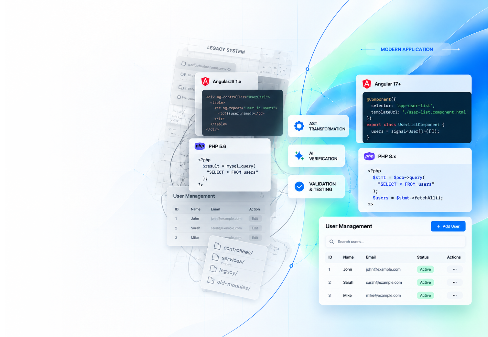
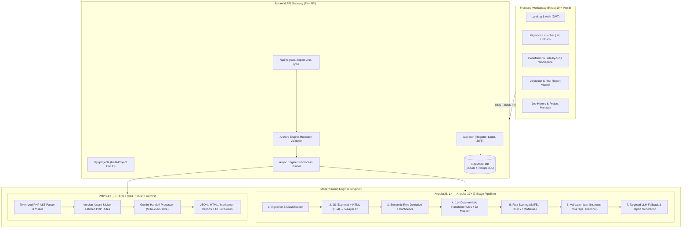

# 🚀 EVUA — Enterprise Visionary Upgrade Assistant

<div align="center">

### Semantic Legacy Code Modernization Platform & Hybrid AST + AI Migration Engine

[](https://www.python.org)
[](https://fastapi.tiangolo.com)
[](https://react.dev)
[](https://vitejs.dev)
[](https://codemirror.net)
[](https://angular.dev)
[](https://www.php.net)

<p align="center">
  <b>5-Layer Semantic IR &bull; Deterministic AST &amp; Rule Transpilers &bull; Targeted AI Handoff &bull; Automated TypeScript/Lint Validation &bull; Side-by-Side Diff Workspace</b>
</p>

[Executive Summary](#-executive-summary) •
[Architecture](#-system-architecture) •
[AngularJS Engine](#-angularjs-1x--angular-17-semantic-engine) •
[PHP Engine](#-php-56--83-modernization-engine) •
[Full-Stack Workspace](#-interactive-modernization-workspace) •
[Getting Started](#-getting-started) •
[API & CLI](#-rest-api--cli-reference)

---

</div>

<div align="center">
  
</div>

---

## 📌 Executive Summary

**EVUA (Enterprise Visionary Upgrade Assistant)** is not a naive regex script or blind LLM wrapper—it is a **full-stack semantic code modernization platform**. Designed to rescue aging enterprise monoliths, EVUA combines **deterministic AST compilers**, a **5-layer Intermediate Representation (IR)**, **automated validation runners**, and **cost-controlled AI fallback verification** to migrate **AngularJS (1.x) → Modern Angular (17+)** and **Legacy PHP (5.6+) → Modern PHP (8.x)**.

Naive "paste-into-an-LLM" migration tools fail on real repositories: they hallucinate APIs, break dependency injection graphs, burn massive token budgets on boilerplate, and leave engineers without verification or audit trails. EVUA solves this with a compiler-inspired hybrid approach:

1. **Deterministic Rules First, AI Only for Edge Cases**: Handles 80–90% of structural transformations (controllers, services, `$http`, `$watch`, routes, templates, PHP deprecated APIs) via fast, auditable AST rules—escalating only `RISKY` or `MANUAL` constructs to Gemini/OpenAI with SHA-256 response caching.
2. **5-Layer Semantic Intermediate Representation (IR)**: Models static structure (`code_model`), runtime semantics (`behavior_model`), directed dependency graphs (`dependency_model`), template bindings (`template_model`), and migration governance (`migration_model`) with UUID-traceable `IRNode` identities.
3. **Automated Risk Scoring & Validation Gate**: Classifies every file change as `SAFE`, `RISKY`, or `MANUAL`, then executes real compiler/quality checks (`tsc`, lint, test, coverage, and snapshot comparison) before generating structured `.evua_report.json` and `.evua_report.md` artifacts.
4. **Interactive Side-by-Side Diff Workspace**: A modern React 19 + CodeMirror 6 (`@codemirror/merge`) UI lets engineers inspect dual Legacy vs. Modern folder trees, review line-by-line diffs (`overwritten`, `new`, `deleted`), explore validation reports, and manage migration job history backed by FastAPI + JWT auth.

---

## ⚡ Key Capabilities

<table>
  <tr>
    <td width="50%">
      <h3>🧠 Semantic Compiler + 5-Layer IR</h3>
      <ul>
        <li>Separates static AST structure from runtime behavior and UI template semantics.</li>
        <li>UUID-based <code>IRNode</code> tracking across every transformation for full auditability.</li>
        <li>Built-in benchmark harness (<code>admin-dashboard</code>, <code>taskflow</code>, <code>bench-100-full-migration</code>).</li>
      </ul>
    </td>
    <td width="50%">
      <h3>🤖 Cost-Controlled AI Handoff</h3>
      <ul>
        <li>Deterministic rules handle standard patterns at zero token cost.</li>
        <li>High-risk / dynamic edge cases hand off cleanly to Gemini or OpenAI adapters.</li>
        <li>Built-in SHA-256 disk caching (<code>.evua/ai_cache</code>), token/USD cost tracking &amp; offline mock mode.</li>
      </ul>
    </td>
  </tr>
  <tr>
    <td width="50%">
      <h3>🌓 CodeMirror 6 Diff Workspace</h3>
      <ul>
        <li>Dual-pane Legacy vs. Modern project tree explorer with status badges (<code>overwritten</code>, <code>new</code>, <code>deleted</code>).</li>
        <li>Interactive side-by-side <code>MergeView</code> diff inspector with syntax highlighting.</li>
        <li>Real-time validation reports (JSON &amp; Markdown export) and historical job browser.</li>
      </ul>
    </td>
    <td width="50%">
      <h3>🔐 Production FastAPI Backend</h3>
      <ul>
        <li>JWT authentication (<code>python-jose</code> + <code>bcrypt</code>) with multi-project user isolation.</li>
        <li>Smart ZIP archive validation that catches engine/file-type mismatches before execution.</li>
        <li>SQLModel persistence (SQLite for local dev, PostgreSQL-ready via <code>DATABASE_URL</code>).</li>
      </ul>
    </td>
  </tr>
</table>

---

## 🏗️ System Architecture

EVUA cleanly separates the **React 19 web workspace**, the **FastAPI orchestration & persistence layer**, and two specialized **CLI-accessible modernization engines** ([architecture docs](documentation/system_architecture.md)):



---

## 🅰️ AngularJS (1.x) → Angular (17+) Semantic Engine

Located in `engine/angularjs/`, this engine executes a strictly layered, 7-stage compiler pipeline backed by EVUA's **5-Layer IR** ([IR specification](documentation/ir-architecture.md) · [pipeline specification](documentation/pipeline-architecture.md)):

### The 5-Layer Intermediate Representation
| IR Layer | Package | Responsibility |
|:---|:---|:---|
| **Structural** | `ir/code_model` | Modules, classes, functions, symbols, and source locations |
| **Behavioral** | `ir/behavior_model` | Lifecycle hooks, data bindings, observers (`$watch`), side effects |
| **Dependency** | `ir/dependency_model` | Directed dependency graph edges across controllers, services & routes |
| **Template** | `ir/template_model` | HTML template bindings, structural directives, expressions |
| **Migration** | `ir/migration_model` | Change records, confidence scores, risk decisions, and snapshots |

### 7-Stage Pipeline & Transformation Rules
1. **Ingestion**: Traverses repositories and classifies `.js`, `.ts`, `.html`, and project configs.
2. **Analysis**: Parses JS via `esprima` and templates via `BeautifulSoup4` into unified IR graphs.
3. **Pattern Detection**: Elevates raw AST facts into semantic roles (`CONTROLLER`, `SERVICE`, `DIRECTIVE`, `HTTP`, `WATCH`) with confidence scoring.
4. **Deterministic Transformation**: Scaffolds an Angular workspace and applies 11+ specialized rules:
   - `controller_to_component` & `directive_to_component` / `directive_to_pipe`
   - `service_to_injectable` & `di_mapper` (Dependency Injection graph translation)
   - `http_to_httpclient` (`$http` / `$resource` → `HttpClient`)
   - `simple_watch_to_rxjs` (`$scope.$watch` → RxJS `BehaviorSubject` / Observables)
   - `route_migrator`, `constants_and_run`, `component_interaction`, `template_migrator`, `app_module_updater`
5. **Risk Assessment**: Assigns `SAFE`, `RISKY`, or `MANUAL` classifications per change.
6. **Validation**: Runs TypeScript compiler (`tsc`), linter (`lint`), unit tests (`tests`), migration coverage (`coverage`), and snapshot diffing (`snapshot`).
7. **AI Stage & Reporting**: Invokes LLM adapters only on high-risk leftovers and emits `.evua_report.json` and `.evua_report.md`.

---

## 🐘 PHP (5.6+) → Modern PHP (8.3) Modernization Engine

Located in `engine/php/`, the PHP engine brings AST-backed analysis, live migration rule fetching, and CI-ready reporting to legacy PHP monoliths:

- **Custom PHP AST Parser & Visitor** (`ast_parser/php_parser.py`): Tokenizes PHP constructs including heredocs/nowdocs, type hints, closures, null-coalescing (`??`), spread operators, classes, and deprecated function calls.
- **Version-Targeted Rule Engine** (`rule_engine/`): Supports migrating across PHP `5.6`, `7.0`, `7.4`, `8.0`, `8.1`, `8.2`, and `8.3`—including a `fetch_live_rules` capability that indexes deprecated APIs, breaking changes, and new language features.
- **Gemini Handoff Processor** (`ai_processor/handoff.py`): Routes flagged complex snippets to Gemini with deterministic SHA-256 caching, token/USD tracking (`AIUsage`), and an offline `mock_mode` for deterministic testing.
- **CI-Ready CLI** (`engine/php/cli.py`): Exposes `analyze`, `migrate`, `report`, and `rules` commands with `--dry-run`, progress bars (`rich`), `json`/`html`/`markdown` outputs, and semantic exit codes (`0` = clean, `1` = manual review required, `2` = AI handoff failure).

---

## 🖥️ Interactive Modernization Workspace

<div align="center">
  
</div>

The **React 19 + Vite 8** frontend (`frontend/src/pages/`) guides engineering teams through the complete modernization lifecycle:
- **Landing & Auth (`landing/`, `Login/`, `Register/`)**: JWT-backed workspace authentication.
- **Migration Launcher (`Migration/`)**: Upload zipped AngularJS or PHP repositories, choose strategy and target version, and launch asynchronous migrations with instant mismatch validation.
- **Diff Workspace (`Workspace/`)**: Dual Legacy vs. Modern folder trees paired with a **CodeMirror 6 `MergeView`** side-by-side diff editor highlighting `overwritten`, `new`, and `deleted` files.
- **Validation & Reporting (`Validation/`)**: Inspect JSON and Markdown migration reports, risk breakdowns, and export artifacts.
- **Analytics & History (`Dashboard/`, `History/`)**: Track project migration metrics, historical runs, and job cleanup.

---

## 💻 Tech Stack

| Layer | Technologies |
|:---|:---|
| **Frontend** | React 19, Vite 8, React Router 7, Tailwind CSS 4, CodeMirror 6 (`@codemirror/merge`), Lucide React |
| **Backend API** | Python 3.12+, FastAPI, Uvicorn, Pydantic v2, SQLModel, SQLAlchemy, `python-jose` (JWT), `bcrypt` |
| **Database** | SQLite (zero-config local default) / PostgreSQL (`psycopg2-binary` via `DATABASE_URL`) |
| **Parsing & Analysis** | `esprima` (JavaScript AST), `BeautifulSoup4` (HTML Templates), Custom Tokenized PHP AST Parser |
| **AI & Reporting** | Gemini / OpenAI / Groq adapters, SHA-256 response cache, Jinja2, PyYAML, Rich CLI, Click |

---

## 📂 Project Structure

```text
EVUA/
├── backend/
│   ├── app/
│   │   ├── core/                # Settings, JWT security helpers & SQLModel DB engine
│   │   ├── models/              # User, Project, Job, MigrationReport schemas
│   │   ├── routes/              # FastAPI routers (auth, projects, migration/jobs/reports)
│   │   ├── services/            # Async engine subprocess runner & report persistor
│   │   └── main.py              # FastAPI entrypoint & CORS setup
│   ├── init_db.py               # Database initializer
│   └── requirements.txt
├── engine/
│   ├── angularjs/
│   │   ├── ir/                  # 5-Layer IR (code, behavior, dependency, template, migration)
│   │   ├── pipeline/            # 7-Stage pipeline (ingestion → analysis → patterns → transform → risk → validation → AI)
│   │   ├── evaluation/          # Benchmark evaluation harness & metrics
│   │   ├── benchmarks/          # AngularJS benchmark apps (admin-dashboard, taskflow, bench-100)
│   │   └── cli.py               # AngularJS migration CLI
│   └── php/
│       ├── ast_parser/          # PHP tokenizer, AST parser & visitor
│       ├── rule_engine/         # Version-aware rules & live PHP migration rule fetcher
│       ├── ai_processor/        # Gemini handoff processor with SHA-256 caching & cost tracking
│       ├── pipeline/            # PHP migration orchestrator
│       └── cli.py               # Rich-powered Click CLI (migrate, analyze, report, rules)
├── documentation/               # Deep-dive IR, pipeline & system architecture docs
├── frontend/
│   ├── src/
│   │   ├── components/          # Navbar & Sidebar navigation
│   │   ├── context/             # AuthContext (JWT session management)
│   │   └── pages/               # Landing, Login, Register, Migration, Workspace, Dashboard, Validation, History
│   └── package.json
└── requirements.txt             # Top-level engine & platform Python dependencies
```

---

## 🛠️ Getting Started

### Prerequisites
- **Python 3.10+** (3.12 recommended)
- **Node.js 18+** (with npm)

### 1. Clone & Install Backend Dependencies
```bash
git clone https://github.com/aasimkhan02/EVUA.git
cd EVUA

python -m venv venv
# Windows PowerShell:
.\venv\Scripts\Activate.ps1
# macOS / Linux:
# source venv/bin/activate

pip install -r backend/requirements.txt
```

### 2. Configure Environment *(Optional for AI Fallback)*
Create a `.env` file inside `backend/`:
```env
DATABASE_URL=sqlite:///./evua.db
SECRET_KEY=change-this-secret-in-production
GEMINI_API_KEY=your_gemini_api_key_here
OPENAI_API_KEY=your_openai_api_key_here
```
*(Deterministic AST migrations and offline mock AI modes work out of the box without API keys.)*

### 3. Start the Backend Server
```bash
cd backend
uvicorn app.main:app --reload --port 8000
```
- **API Root**: `http://localhost:8000`
- **Interactive Swagger Docs**: `http://localhost:8000/docs`
- **Health Check**: `http://localhost:8000/health`

### 4. Start the Frontend Workspace
In a separate terminal:
```bash
cd frontend
npm install
npm run dev
```
Open **`http://localhost:5173`** in your browser.

---

## 🔌 REST API & CLI Reference

### Backend REST Endpoints
| Method | Endpoint | Description |
|:---|:---|:---|
| `GET` | `/health` | Backend health check |
| `POST` | `/api/auth/register` | Register a new workspace user |
| `POST` | `/api/auth/login` | Authenticate and receive JWT access token |
| `GET` | `/api/auth/me` | Retrieve authenticated user profile |
| `GET / POST` | `/api/projects/` | List or create modernization projects |
| `POST` | `/api/migrate` | Upload `.zip` codebase & execute AngularJS or PHP engine |
| `GET` | `/api/report` | Fetch generated JSON or Markdown migration report |
| `GET` | `/api/file` | Retrieve migrated file source for side-by-side inspection |
| `GET / DELETE` | `/api/jobs` | List migration job history or delete jobs |

### Standalone Engine CLIs
Run either engine directly from the repository root (with Python `venv` active):

```bash
# PHP Engine: Analyze legacy PHP 5.6 code targeting PHP 8.2 (dry-run)
python -m engine.php.cli analyze --path engine/php/old_php_project --source-version 5.6 --target-version 8.2

# PHP Engine: List cached/live migration rules for PHP 8.2
python -m engine.php.cli rules --list --php-version 8.2

# PHP Engine: Migrate with Markdown report output
python -m engine.php.cli migrate --path engine/php/old_php_project --source-version 5.6 --target-version 8.2 --output .evua/report.md --format markdown
```

---

## 🧪 Testing & Benchmarks

EVUA includes unit tests across its AngularJS pipeline contracts and PHP engine, plus benchmark repositories (`engine/angularjs/benchmarks/angularjs/`) for regression validation:

```bash
# Run AngularJS pipeline contract & unit tests
pytest engine/angularjs/pipeline/tests -v
```

---

<div align="center">
  <sub>Modernizing legacy codebases with compiler precision &bull; Engineered by <a href="https://github.com/aasimkhan02">Aasim Khan</a></sub>
</div>
